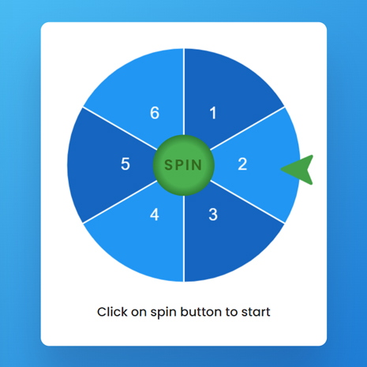

# Spin Wheel

A spin-the-wheel app drawn with Chart.js.

## Features

- Six-segment wheel that slows down before stopping
- Shows the value the wheel lands on

## Run it

No build step. Open `index.html` in a browser, or serve the folder with any static server, for example `python -m http.server`.

## Notes

- Chart.js and its datalabels plugin load from a CDN.

## Screenshots

